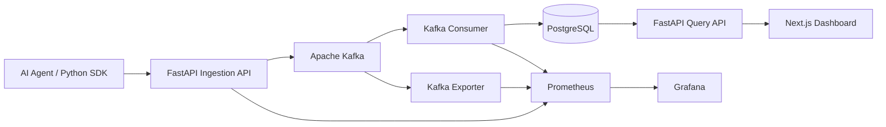

<div align="center">

# AgentScope

### Trace every agent step. Understand every failure.

**An event-driven observability platform for AI-agent workflows.**  
Capture agent, LLM, and tool spans; stream telemetry through Kafka; investigate executions and failures in a Next.js dashboard.

[](packages/python-sdk/)
[](apps/api/)
[](https://kafka.apache.org/)
[](https://www.postgresql.org/)
[](apps/web/)
[](docker-compose.yml)

</div>

AgentScope is an open-source, distributed observability project for instrumenting AI-agent execution. Its Python SDK records nested agent, tool, and LLM spans; FastAPI accepts telemetry; Kafka decouples ingestion from persistence; and PostgreSQL stores traces for querying and analysis.

The project also includes **automatic instrumentation for synchronous OpenAI Chat Completions**, **evidence-backed failure diagnosis**, and **Prometheus/Grafana monitoring configuration**. Kubernetes deployment manifests are provided for local-cluster experimentation.

> **Project scope:** Built and tested as a local development and demonstration platform, not a production-hosted SaaS. Evaluation numbers below come from controlled experiments and synthetic scenarios; they are not production accuracy or throughput guarantees.

## At a Glance

| Capability | Implementation |
|---|---|
| **Instrumentation** | Python SDK with nested spans, context propagation, and automatic OpenAI Chat Completions tracing |
| **Telemetry pipeline** | FastAPI → Kafka → consumer → PostgreSQL |
| **Trace exploration** | Next.js execution dashboard, waterfall view, span details, errors, and token metadata |
| **Failure investigation** | Provider-aware classification, root-cause localization, supporting span evidence, suggested remediation |
| **Monitoring** | Prometheus metrics, Grafana dashboards, Kafka exporter configuration |
| **Reliability** | Consumer recovery and duplicate-span protection tested under controlled conditions |

### Measured Results

| Experiment | Observed result | Scope |
|---|---|---|
| Consumer outage and recovery | **30/30** submitted events recovered; consumer lag **30 → 0** | Controlled Kafka consumer downtime |
| Duplicate event submission | **1** stored row for **2** submissions sharing a `span_id` | Database-level idempotency |
| Diagnosis evaluation | **138/150 → 150/150** after tuning | Same 150 synthetic scenarios, not an independent post-tuning holdout |
| Live OpenAI failure tracing | **2** spans captured for one propagated API failure | Single HTTP 429 integration test |

## Contents

- [Architecture](#architecture)
- [Features](#features)
- [Automated Root-Cause Diagnosis](#automated-root-cause-diagnosis)
- [Evaluation and Validation](#evaluation-and-validation)
- [Repository Structure](#repository-structure)
- [Getting Started](#getting-started)
- [Python SDK](#python-sdk)
- [Integration Verification](#integration-verification)
- [Reliability Testing](#reliability-testing)
- [API Overview](#api-overview)
- [Engineering Decisions](#engineering-decisions)
- [Stopping the Platform](#stopping-the-platform)

---

## Architecture



Kafka decouples ingestion from persistence, allowing trace events to accumulate while the database-writing consumer is temporarily unavailable.

### How It Works

1. An AI application generates execution spans using the AgentScope Python SDK.
2. The FastAPI ingestion endpoint validates and publishes spans to Kafka.
3. A separate Kafka consumer processes events and persists them in PostgreSQL.
4. The FastAPI query endpoints retrieve stored runs and spans.
5. The Next.js dashboard displays execution timelines, metadata, and errors.
6. Prometheus and Grafana provide infrastructure-level monitoring when the monitoring Compose overlay is enabled.

---

## Features

The following capabilities are implemented in the repository. Some require the monitoring Compose overlay or optional OpenAI SDK dependency.

### Distributed Trace Ingestion

- HTTP-based trace ingestion through FastAPI
- Kafka-backed asynchronous processing
- Agent, LLM, and tool span classification
- Unique run and span identifiers
- Parent-child span relationships
- Structured JSON metadata stored in PostgreSQL

### Python Instrumentation SDK

The Python SDK supports:

- Context-managed traces and nested spans
- Automatic execution latency measurement
- Error status and exception-message capture
- Parent-span propagation within an execution context
- HTTP publishing to the AgentScope ingestion API
- Automatic OpenAI Chat Completions instrumentation (v0.2)

### Automatic OpenAI Instrumentation

AgentScope can automatically capture synchronous OpenAI Chat Completions calls inside an active trace.

Captured information includes:

- Model name and provider
- Request latency
- Prompt tokens, completion tokens, and total tokens
- API exceptions and error messages
- Parent-child relationships between agent and LLM spans

This allows developers to inspect model execution without manually creating an LLM span around every API call.

### Trace Visualization

The web interface supports light and dark themes, an execution overview, status filtering, run inspection, and a dedicated failure diagnosis view.

> **Screenshot gallery:** Add actual captures of the overview, trace waterfall, and diagnosis screen here once the images are committed to the repository. Avoid mock screenshots presented as live product output.


The Next.js dashboard provides:

- Agent execution run summaries
- Run-level trace inspection
- Span status and execution details
- Trace waterfall visualization
- Error highlighting and exception messages
- Token usage and estimated LLM costs from recorded metadata

### Infrastructure Observability

Prometheus collects metrics from the ingestion API, Kafka consumer, and Kafka exporter.

Grafana visualizes:

- Total traces ingested
- Ingestion errors
- Consumer processing counts
- Kafka consumer lag

### Reliability

- Kafka consumer offsets committed after database writes
- PostgreSQL duplicate protection using `ON CONFLICT DO NOTHING`
- Kafka-backed buffering during consumer downtime
- Persistent Kafka and PostgreSQL Docker volumes
- Kubernetes deployment manifests for local cluster testing

---

## Automated Root-Cause Diagnosis

AgentScope goes beyond displaying execution traces: it analyzes failed
agent workflows and identifies likely root causes using structured
provider errors, execution context, and trace relationships.

### Diagnosis Capabilities

- **Provider-aware error classification:** Recognizes quota exhaustion,
  rate limiting, authentication failures, timeouts, and connection errors.
- **Structured error precedence:** Uses provider error codes and types
  before falling back to message-based heuristics.
- **Root-cause localization:** Uses parent-child span relationships to
  distinguish originating failures from propagated errors.
- **Multiple failure detection:** Identifies independent failures
  within the same agent execution.
- **Evidence-backed explanations:** Returns the originating span,
  failure classification, explanation, and suggested remediation.
- **Defensive metadata handling:** Handles missing and malformed
  error metadata without crashing the diagnosis engine.

The dashboard displays diagnosis findings alongside execution
waterfalls, making it easier to investigate failed agent runs.

### Diagnosis API

```http
GET /v1/runs/{run_id}/diagnosis
```

The endpoint returns the run status, diagnosis count, and a list
of findings with supporting span evidence.

---

## Evaluation and Validation

The diagnosis engine was evaluated using deterministic, labeled
synthetic agent execution scenarios.

### Results

| Evaluation | Scenarios | Exact-case accuracy | Precision | Recall | F1 |
|---|---:|---:|---:|---:|---:|
| Development regression | 100 | 100% | 100% | 100% | 1.00 |
| Initial holdout baseline | 100 | 86% | 88.24% | 88.24% | 0.8824 |
| Initial holdout after tuning | 100 | 100% | 100% | 100% | 1.00 |
| Additional holdout baseline | 150 | 92% | 92.26% | 92.26% | 0.9226 |
| Additional holdout after tuning | 150 | 100% | 100% | 100% | 1.00 |

**Metric definitions:**

- **Exact-case accuracy:** Percentage of scenarios with the expected
  run status and exact set of diagnosis codes and originating spans.
- **Precision and recall:** Calculated from expected and predicted
  diagnosis classifications.
- **Evidence accuracy:** Measures whether the correct originating
  spans were identified.

### Evaluation Methodology

The development suite contains 100 synthetic scenarios covering
provider failures, successful runs, and propagated errors.

An initial 100-case holdout identified gaps in provider-specific
error handling. After targeted improvements, all 100 cases passed
the post-tuning regression.

A separate 150-case synthetic evaluation covered:

| Category | Scenarios |
|---|---:|
| Provider-specific errors | 30 |
| Conflicting evidence | 25 |
| Nested failure chains | 25 |
| Multiple independent failures | 20 |
| Missing and malformed metadata | 20 |
| Successful runs and false-positive traps | 15 |
| Unusual error formats | 15 |
| **Total** | **150** |

The frozen diagnosis engine initially passed **138/150 scenarios
(92%)**. All 12 failures involved provider-specific error wording.

After introducing provider-aware normalization and additional
error patterns, the engine passed **150/150 scenarios (100%)**
on the same dataset.

### Reproduce the Evaluations

Run the development regression suite:

```bash
PYTHONPATH=. python3 evaluations/run_all.py
```

Run the post-tuning comparison against the preserved 150-case baseline:

```bash
PYTHONPATH=. python3 evaluations/final_holdout/compare.py
```

The evaluation artifacts are stored under `evaluations/`, including
the original baselines, labeled scenarios, and comparison results.

**Limitations:** These are synthetic, manually constructed scenarios,
not production incidents. The post-tuning scores were obtained on
datasets already examined during development and must not be
interpreted as independent holdout or production accuracy.
The additional 150-case dataset was also designed with knowledge
of the existing diagnosis engine.

---

## Repository Structure

AgentScope uses a monorepo layout: deployable applications live in `apps/`, reusable instrumentation in `packages/`, and deployment/monitoring configuration in `infra/`. The tree below reflects the documented project layout; it is intentionally selective rather than an exhaustive listing of every source file.

```text
agentscope/
├── apps/
│   ├── api/                      # FastAPI API and Kafka consumer
│   └── web/                      # Next.js dashboard
├── packages/
│   └── python-sdk/
│       ├── pyproject.toml
│       └── agentscope/
│           ├── __init__.py
│           ├── tracer.py
│           └── openai_instrumentation.py
├── examples/
│   ├── demo-agent/               # Synthetic trace generator
│   └── openai-agent/             # OpenAI integration example
├── infra/
│   ├── grafana/                  # Grafana provisioning
│   ├── prometheus/               # Prometheus scrape configuration
│   └── k8s/                      # Kubernetes manifests
├── tests/
│   └── test_openai_integration.py
├── docker-compose.yml
├── docker-compose.monitoring.yml
└── README.md
```

---

## Getting Started

### Prerequisites

- Docker with Docker Compose
- Python 3.11+ for running the SDK and examples
- An OpenAI API key for live OpenAI requests (optional)

### Start the Platform

Clone the repository:

```bash
git clone https://github.com/adjascently/agentscope.git
cd agentscope
```

Build the application images:

```bash
docker build -f apps/api/Dockerfile -t agentscope-api:day3 .
docker build -f apps/web/Dockerfile -t agentscope-web:day2 .
```

Create the persistent Kafka volume:

```bash
docker volume create agentscope_kafka_data
```

Start the services:

```bash
docker compose -f docker-compose.yml -f docker-compose.monitoring.yml up -d
```

The `kafka-init` service automatically creates the `agent-traces` Kafka topic during startup.

### Service URLs

| Service | URL |
|---|---|
| Next.js Dashboard | http://localhost:3000 |
| FastAPI Documentation | http://localhost:8000/docs |
| FastAPI Metrics | http://localhost:8000/metrics |
| Prometheus | http://localhost:9091 |
| Grafana | http://localhost:3001 |

Grafana uses development credentials configured in Docker Compose. Change them before deploying outside a local environment.

### Generate Demo Traces

With the platform running, execute:

```bash
python3 examples/demo-agent/generate_traces.py
```

The generator publishes three simulated workflows:

1. **Research Assistant:** Planning, LLM calls, web search, and final response.
2. **Code Review Agent:** Repository inspection, LLM analysis, simulated test failure, and recovery.
3. **Customer Support Agent:** Planning, knowledge-base search, LLM response, and final answer.

The script generates **15 synthetic spans** across these three workflows.

Open http://localhost:3000 to inspect the generated runs.

---

## Python SDK

### Installation

From the repository root:

```bash
python3 -m venv .venv
source .venv/bin/activate
pip install -e "./packages/python-sdk[openai]"
```

The package distribution is named `agentscope-observability`, while the Python import remains `agentscope`.

### Manual Tracing

```python
from agentscope import AgentScope

tracer = AgentScope(endpoint="http://127.0.0.1:8000")

with tracer.trace("research-agent") as run_id:
    with tracer.span("plan", span_type="agent"):
        print("Planning research")

    with tracer.span(
        "llm.generate",
        span_type="llm",
        metadata={"model": "gpt-4o", "tokens": 150},
    ):
        print("Generating response")

    with tracer.span("search", span_type="tool"):
        print("Searching for information")

print("Run ID:", run_id)
```

The SDK measures span duration, captures errors, and publishes completed spans to the ingestion API.

### Automatic OpenAI Instrumentation (v0.2)

Instead of manually wrapping every OpenAI request, developers can instrument an OpenAI client.

```python
from openai import OpenAI
from agentscope import AgentScope, instrument_openai

tracer = AgentScope(endpoint="http://localhost:8000")
client = instrument_openai(OpenAI(), tracer)

with tracer.trace("research-assistant") as run_id:
    response = client.chat.completions.create(
        model="gpt-4o-mini",
        messages=[
            {
                "role": "user",
                "content": "Explain Apache Kafka in two sentences."
            }
        ],
    )

    print(response.choices[0].message.content)

print("Run ID:", run_id)
```

Set `OPENAI_API_KEY` in your environment before running.

OpenAI API billing is separate from ChatGPT subscriptions.

#### What Gets Recorded?

Each instrumented request creates an LLM span with metadata such as:

```json
{
  "provider": "openai",
  "model": "gpt-4o-mini",
  "prompt_tokens": 20,
  "completion_tokens": 15,
  "tokens": 35,
  "latency_ms": 125.4
}
```

The values above are illustrative. Actual token usage and latency depend on the request.

On an API exception, AgentScope records the span with `status: error` and captures the exception message.

#### Current Instrumentation Scope

- Synchronous, non-streaming OpenAI Chat Completions
- Requires an active `AgentScope.trace()` context
- Streaming and asynchronous instrumentation are not yet supported
- Other LLM providers are not yet automatically instrumented

See `examples/openai-agent/main.py` for an executable example.

---

## Integration Verification

### Live OpenAI API Failure

A real OpenAI API request was executed using `gpt-4o-mini`.

The request returned HTTP 429 with the error code `credit_balance_exhausted` because the API project had no remaining credits.

AgentScope successfully captured:

- An agent span and nested LLM span
- The OpenAI model name
- Request execution latency
- The API exception and error message
- The parent-child relationship
- Both failed spans in the Next.js dashboard

**Observed result:** 2 spans, 2 error statuses, and a 2.26-second overall execution timeline.

These represent one underlying API failure propagated through two execution spans, not two independent failed API requests.

### Mocked Successful OpenAI Response

A mocked OpenAI response was used to validate successful-response instrumentation without consuming API credits.

The mock returned:

| Metric | Recorded value |
|---|---:|
| Prompt tokens | 20 |
| Completion tokens | 15 |
| Total tokens | 35 |
| Captured spans | 2 |
| Error spans | 0 |

The test verified that the OpenAI instrumentation extracts token usage and publishes it through the existing AgentScope pipeline.

**Verification boundary:** Live API error tracing and mocked successful-response tracing have been verified. A successful live OpenAI API response has not yet been tested.

---

## Reliability Testing

### Kafka Consumer Failure Recovery

A controlled experiment was performed to validate Kafka buffering and consumer recovery.

**Procedure:**

1. Stop the Kafka consumer.
2. Submit 30 trace events through the FastAPI ingestion endpoint.
3. Confirm that Kafka consumer lag increases.
4. Restart the consumer.
5. Verify that queued events are processed and persisted.

**Observed results:**

| Metric | Result |
|---|---|
| Trace submissions | 30 |
| Successful HTTP submissions | 30/30 |
| Observed consumer lag during downtime | 30 |
| Observed lag after recovery | 0 |
| Traces recovered in PostgreSQL | 30/30 |
| Observed ingestion errors | 0 |

This experiment demonstrated successful buffering and recovery under the tested consumer-downtime scenario.

### Duplicate Protection

The same trace event was submitted twice using an identical `span_id`.

Both requests were accepted by the ingestion API, while PostgreSQL stored one row for that span identifier.

This demonstrates database-level idempotency for duplicate span IDs.

---

## API Overview

| Endpoint | Method | Purpose |
|---|---|---|
| `/health` | GET | API health check |
| `/v1/traces` | POST | Ingest a trace event |
| `/v1/runs` | GET | List recorded runs |
| `/v1/run/{run_id}` | GET | Retrieve spans for a run |
| `/v1/analytics` | GET | Retrieve execution analytics |
| `/v1/runs/{run_id}/diagnosis` | GET | Retrieve diagnosis findings for a run |
| `/metrics` | GET | Prometheus metrics |
| `/docs` | GET | Interactive API documentation |

The running FastAPI OpenAPI specification at `/docs` is the source of truth for the exact request and response schemas.

---
## Engineering Decisions

AgentScope is designed around three priorities: **reliable telemetry ingestion, independent service scaling, and developer-friendly instrumentation.**

| Component | Design Decision | Engineering Rationale |
|:---|:---|:---|
| **Apache Kafka** | Asynchronous event streaming | Decouples trace ingestion from persistence, buffers events during consumer downtime, and enables independent scaling. |
| **PostgreSQL** | Relational storage with JSONB | Supports indexed run-level queries while accommodating flexible metadata from agents, LLMs, and tools. |
| **Dedicated Consumer** | Independent event processing | Separates API requests from database writes, commits offsets after persistence, and handles duplicate spans safely. |
| **Prometheus + Grafana** | Infrastructure monitoring | Tracks ingestion throughput, processing errors, and Kafka consumer lag alongside application-level traces. |
| **Python SDK** | Context-managed instrumentation | Simplifies nested tracing, latency measurement, exception capture, and execution-context propagation. |
| **OpenAI Instrumentation** | Automatic LLM call tracing | Captures model metadata, token usage, latency, and API errors without requiring manual instrumentation for each call. |

### Key Architectural Trade-off

AgentScope favors **modularity and recoverability over minimal infrastructure complexity**. Using Kafka and a dedicated consumer introduces additional services, but allows telemetry ingestion and persistence to operate independently. This design was validated through a controlled recovery test in which **30/30 queued traces were successfully persisted** after the consumer restarted.

---
## Stopping the Platform

```bash
docker compose -f docker-compose.yml -f docker-compose.monitoring.yml down
```

Persistent Docker volumes are retained unless explicitly removed.

---

**AgentScope — Built to make AI-agent execution observable, debuggable, and measurable.**

---

<div align="center">

**AgentScope — Making AI-agent execution observable, debuggable, and measurable.**

Built by [Jasmaine Khale](https://github.com/adjascently).

</div>
