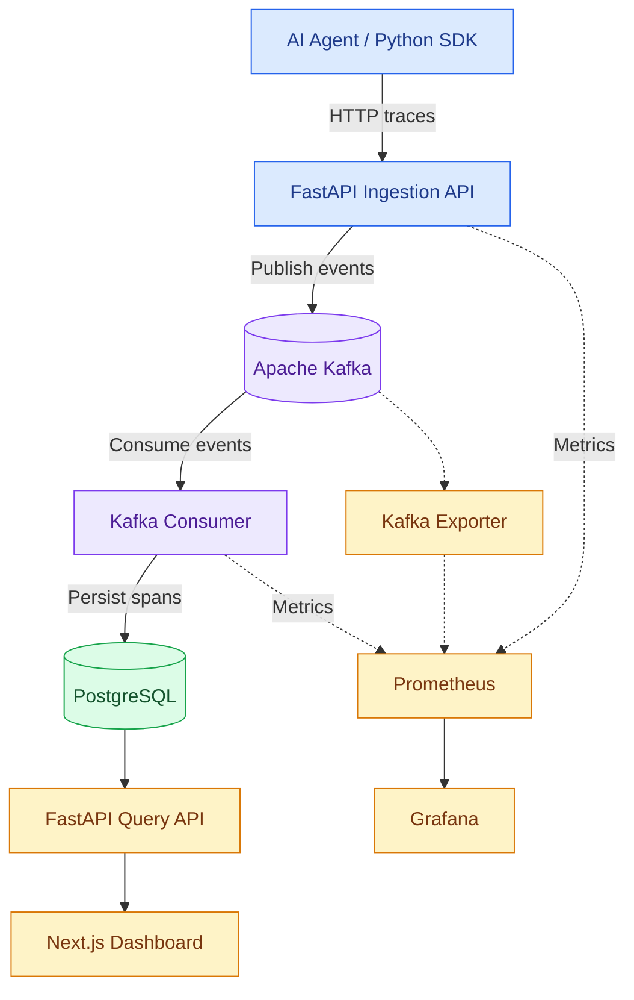
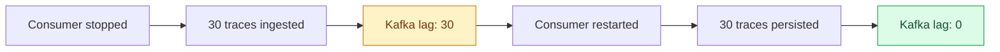

# AgentScope

### See inside your AI agents. Understand every step.

**AgentScope** is an open-source, self-hosted observability platform for AI-agent workflows. Capture execution traces, inspect nested LLM and tool calls, analyze latency and token usage, and monitor the infrastructure behind your agents.

Built for developers who want to understand **what happened, where time was spent, and what failed**—without treating agent execution as a black box.

[**GitHub Repository**](https://github.com/adjascently/agentscope) · [**Quick Start**](#quick-start) · [**Architecture**](#architecture) · [**SDK Usage**](#python-sdk)


---

## Why AgentScope?

AI agents rarely execute as a single operation. They plan, call language models, retrieve information, invoke tools, and retry failed steps.

When something goes wrong, ordinary application logs often make it difficult to reconstruct the full execution.

AgentScope brings those operations together into one observable workflow.

| Without AgentScope | With AgentScope |
|---|---|
| Scattered logs across agent components | Structured traces grouped by execution run |
| Unclear execution bottlenecks | Span-level latency and waterfall views |
| Limited visibility into LLM usage | Token and estimated cost summaries from recorded metadata |
| Difficult failure investigation | Error status and execution metadata |
| No visibility into ingestion backlog | Kafka lag and consumer metrics |

**The goal:** Make AI-agent execution easier to inspect, debug, and measure.

---

## Product Preview

### 01 — Agent Run Dashboard

Browse recorded agent runs, inspect execution status, and review aggregate activity.


### 02 — Execution Trace Waterfall

Explore individual agent runs through nested spans, including LLM calls, tool executions, duration, and errors.


### 03 — Infrastructure Monitoring

Monitor ingestion activity, consumer processing, errors, and Kafka backlog using Prometheus and Grafana.


> **Screenshot note:** These paths are placeholders. Add actual screenshots from your running application to `docs/images/` before publishing this section.

---

## Features

### End-to-End Agent Tracing

- Capture agent, LLM, and tool execution spans
- Correlate operations using run and span identifiers
- Preserve parent-child execution relationships
- Record duration, status, and structured metadata
- Inspect completed runs through the web dashboard

### Lightweight Python SDK

- Context-managed traces and nested spans
- Automatic span duration measurement
- Exception and error capture
- Parent-span propagation within execution context
- HTTP-based trace publishing

### Real-Time Event Pipeline

- FastAPI trace ingestion
- Apache Kafka event streaming
- Independent database-writing consumer
- PostgreSQL persistence with JSONB metadata
- Consumer offset commits after successful database writes

### Developer Dashboard

- Run summaries and execution details
- Trace waterfall visualization
- Span status and timing
- Token usage summaries
- Estimated LLM costs based on supplied metadata

### Infrastructure Observability

- Prometheus application metrics
- Kafka exporter integration
- Grafana monitoring
- Kafka consumer lag visibility
- Docker Compose and Kubernetes deployment configurations

---

## Architecture

AgentScope separates event collection, asynchronous processing, storage, and visualization.



### How a trace moves through AgentScope

1. **Instrument:** The Python SDK captures an agent operation and its execution metadata.
2. **Ingest:** FastAPI accepts the trace event and publishes it to Kafka.
3. **Buffer:** Kafka retains events independently of the database-writing consumer.
4. **Persist:** The consumer writes spans to PostgreSQL and commits offsets after successful processing.
5. **Explore:** The Next.js dashboard retrieves stored runs and displays their execution details.
6. **Monitor:** Prometheus and Grafana expose the health of the ingestion pipeline.

This separation allows trace ingestion and database persistence to operate independently.

---

## Quick Start

### Prerequisites

- Docker and Docker Compose
- Python 3.11+ for local demo scripts
- Git

### 1. Clone the repository

```bash
git clone https://github.com/adjascently/agentscope.git
cd agentscope
```

### 2. Build the application images

```bash
docker build -f apps/api/Dockerfile -t agentscope-api:day3 .
docker build -f apps/web/Dockerfile -t agentscope-web:day2 .
```

### 3. Initialize persistent storage

```bash
docker volume create agentscope_kafka_data
```

### 4. Start AgentScope

```bash
docker compose \
  -f docker-compose.yml \
  -f docker-compose.monitoring.yml \
  up -d
```

The Docker Compose configuration includes a Kafka initialization service that creates the `agent-traces` topic when needed.

### 5. Generate sample agent activity

```bash
python3 examples/demo-agent/generate_traces.py
```

The demo generator produces **15 synthetic spans across three workflows**:

| Workflow | Spans | Simulated activity |
|---|---:|---|
| Research Assistant | 5 | Planning, LLM calls, web search, response |
| Code Review Agent | 6 | Repository inspection, analysis, test failure, recovery |
| Customer Support Agent | 4 | Planning, knowledge-base lookup, response |

### 6. Explore the platform

| Service | Local URL |
|---|---|
| AgentScope Dashboard | http://localhost:3000 |
| FastAPI Documentation | http://localhost:8000/docs |
| FastAPI Metrics | http://localhost:8000/metrics |
| Prometheus | http://localhost:9091 |
| Grafana | http://localhost:3001 |

Grafana uses local development credentials defined in Docker Compose. Change them before exposing the service beyond your development environment.

---

## Python SDK

Instrument custom Python workflows with context-managed traces and spans.

```python
from agentscope import AgentScope

tracer = AgentScope(endpoint="http://127.0.0.1:8000")

with tracer.trace("research-agent") as run_id:

    with tracer.span("plan", span_type="agent"):
        print("Planning research")

    with tracer.span(
        "llm.generate",
        span_type="llm",
        metadata={
            "model": "gpt-4o",
            "tokens": 150,
        },
    ):
        print("Generating response")

    with tracer.span("search", span_type="tool"):
        print("Searching for information")

print("Run ID:", run_id)
```

The SDK records execution timing, captures exceptions, maintains parent-span context, and sends completed spans to the ingestion API.

The current SDK requires the `requests` package and is included in the repository under `packages/python-sdk/`. Automatic framework instrumentation is not yet implemented.

---

## Reliability Engineering

AgentScope was tested against controlled consumer failures and duplicate event submissions.

### Consumer Failure Recovery

**Experiment:** Stop the Kafka consumer, submit trace events, observe the backlog, and restart processing.

| Measurement | Observed result |
|---|---:|
| Trace events submitted | 30 |
| Successful ingestion responses | 30/30 |
| Kafka consumer lag during outage | 30 |
| Consumer lag after recovery | 0 |
| Events recovered in PostgreSQL | 30/30 |
| Ingestion errors observed | 0 |

**Result:** All 30 events were successfully persisted after the consumer restarted in this test.



### Duplicate Event Protection

The same trace event was submitted twice using an identical `span_id`.

- Both ingestion requests were accepted.
- PostgreSQL stored one row for the span identifier.
- Duplicate inserts were handled using `ON CONFLICT DO NOTHING`.

This provides database-level idempotency for duplicate span IDs.

**Reliability design:** Kafka offsets are committed after database persistence, allowing uncommitted events to be reprocessed following consumer failures.

These experiments validate specific failure scenarios, not production-scale reliability or throughput.

---

## API Reference

| Method | Endpoint | Description |
|---|---|---|
| `GET` | `/health` | API health check |
| `POST` | `/v1/traces` | Ingest a trace event |
| `GET` | `/v1/runs` | List recorded runs |
| `GET` | `/v1/traces/{run_id}` | Retrieve spans associated with a run |
| `GET` | `/metrics` | Prometheus metrics |
| `GET` | `/docs` | Interactive API documentation |

See the local FastAPI documentation for request and response schemas.

---

## Technology Stack

| Layer | Technologies |
|---|---|
| Instrumentation | Python, context managers, ContextVar |
| API | FastAPI, Uvicorn |
| Streaming | Apache Kafka |
| Persistence | PostgreSQL, JSONB |
| Frontend | Next.js, React, TypeScript |
| Metrics | Prometheus, Kafka Exporter |
| Monitoring | Grafana |
| Containerization | Docker, Docker Compose |
| Orchestration | Kubernetes, kind |

---

## Repository Structure

```text
agentscope/
├── apps/
│   ├── api/                 # FastAPI ingestion and consumer
│   └── web/                 # Next.js dashboard
│
├── packages/
│   └── python-sdk/          # Python tracing SDK
│
├── examples/
│   └── demo-agent/          # Synthetic agent workflows
│
├── infra/
│   ├── grafana/             # Grafana datasource provisioning
│   ├── prometheus/          # Prometheus configuration
│   └── k8s/                 # Kubernetes manifests
│
├── tests/
├── docker-compose.yml
├── docker-compose.monitoring.yml
└── README.md
```

---

## Engineering Trade-offs

**Why Kafka instead of direct database writes?**

Kafka decouples ingestion from persistence and provides a buffer during temporary consumer outages.

**Why PostgreSQL?**

PostgreSQL supports indexed run lookups, structured queries, and flexible JSONB metadata storage.

**Why a separate consumer?**

Independent ingestion and persistence components allow failures and processing delays to be handled separately.

**Why manual offset commits?**

Offsets are committed after successful database operations so events can be retried if processing fails before acknowledgment.

**Why Prometheus and Grafana?**

They provide operational visibility into ingestion, consumer activity, errors, and event backlog.

---

## Current Limitations

AgentScope is currently intended for local development and demonstration.

- Single Kafka broker with replication factor one
- No authentication or multi-tenancy
- SDK HTTP failures are logged without automatic retries
- Token usage and cost estimates depend on recorded metadata
- Synthetic demo workflows do not invoke live LLM providers
- Grafana dashboard setup may require manual configuration
- Production security, scalability, and operational hardening remain future work

---

## Stop the Platform

```bash
docker compose \
  -f docker-compose.yml \
  -f docker-compose.monitoring.yml \
  down
```

Persistent volumes are retained unless explicitly removed.

---

## Project Links

**Repository:** [github.com/adjascently/agentscope](https://github.com/adjascently/agentscope)

**AgentScope** — Making AI-agent execution observable, debuggable, and measurable.

*Built with a focus on event-driven architecture, developer tooling, and distributed-system reliability.*
