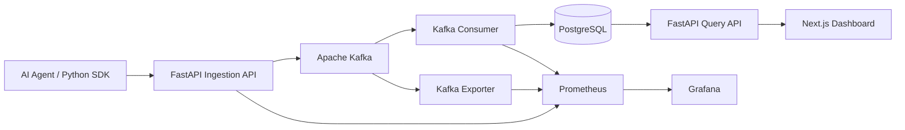

# AgentScope

### Real-Time Observability for AI Agents

**AgentScope** is a distributed observability platform for AI-agent workflows. It captures agent, LLM, and tool execution spans, streams them through Apache Kafka, persists them in PostgreSQL, and visualizes execution traces through a Next.js dashboard.

The platform also exposes Prometheus metrics, Grafana dashboards, and Kubernetes deployment manifests.

**Built with:** Python · FastAPI · Apache Kafka · PostgreSQL · Next.js · TypeScript · Docker · Kubernetes · Prometheus · Grafana

## Architecture



The ingestion and persistence layers are decoupled using Kafka, allowing trace events to accumulate while the database-writing consumer is temporarily unavailable.

## Features

### Distributed Trace Ingestion

- HTTP-based trace ingestion through FastAPI
- Kafka-backed asynchronous processing
- Agent, LLM, and tool span classification
- Unique run and span identifiers
- Parent-child span relationships
- Structured JSON metadata stored in PostgreSQL

### Python Instrumentation SDK

The lightweight Python SDK supports:

- Context-managed traces and nested spans
- Automatic execution latency measurement
- Error status and exception-message capture
- Parent-span propagation within execution context
- HTTP publishing to the AgentScope ingestion API

### Trace Visualization

The Next.js dashboard provides:

- Agent execution run summaries
- Run-level trace inspection
- Span status and execution details
- Trace waterfall visualization
- Token usage and estimated LLM costs from recorded metadata

### Infrastructure Observability

Prometheus collects metrics from the ingestion API, Kafka consumer, and Kafka exporter.

Grafana visualizes:

- Total traces ingested
- Ingestion errors
- Consumer processing counts
- Kafka consumer lag

### Reliability

- Kafka consumer offsets committed after database writes
- PostgreSQL duplicate protection using `ON CONFLICT DO NOTHING`
- Kafka-backed buffering during consumer downtime
- Persistent Kafka and PostgreSQL Docker volumes
- Kubernetes deployment manifests for local cluster testing

## Getting Started

### Prerequisites

- Docker with Docker Compose
- Python 3.11+ for running the demo scripts locally

### Start the Platform

Clone the repository and enter the project directory.

Build the application images:

```bash
docker build -f apps/api/Dockerfile -t agentscope-api:day3 .
docker build -f apps/web/Dockerfile -t agentscope-web:day2 .
```

Create the Kafka volume:

```bash
docker volume create agentscope_kafka_data
```

Start the services:

```bash
docker compose -f docker-compose.yml -f docker-compose.monitoring.yml up -d
```

Create the Kafka topic if it does not already exist:

```bash

```

### Service URLs

| Service | URL |
|---|---|
| Next.js Dashboard | http://localhost:3000 |
| FastAPI Documentation | http://localhost:8000/docs |
| FastAPI Metrics | http://localhost:8000/metrics |
| Prometheus | http://localhost:9091 |
| Grafana | http://localhost:3001 |

Grafana uses development credentials configured in Docker Compose. Change them before deploying outside a local environment.

### Generate Demo Traces

With the platform running, execute:

```bash
python3 examples/demo-agent/generate_traces.py
```

The generator publishes three simulated workflows:

1. **Research Assistant:** Planning, LLM calls, web search, and final response.
2. **Code Review Agent:** Repository inspection, LLM analysis, simulated test failure, and recovery.
3. **Customer Support Agent:** Planning, knowledge-base search, LLM response, and final answer.

The script generates **15 synthetic spans** across these three workflows.

Open http://localhost:3000 to inspect the generated runs.

## Python SDK Example

```python
from agentscope import AgentScope

tracer = AgentScope(endpoint="http://127.0.0.1:8000")

with tracer.trace("research-agent") as run_id:
    with tracer.span("plan", span_type="agent"):
        print("Planning research")

    with tracer.span(
        "llm.generate",
        span_type="llm",
        metadata={"model": "gpt-4o", "tokens": 150},
    ):
        print("Generating response")

    with tracer.span("search", span_type="tool"):
        print("Searching for information")

print("Run ID:", run_id)
```

The SDK measures span duration, captures errors, and publishes completed spans to the ingestion API. It requires the `requests` Python package.

## Reliability Testing

### Kafka Consumer Failure Recovery

A controlled experiment was performed to validate Kafka buffering and consumer recovery.

**Procedure:**

1. Stop the Kafka consumer.
2. Submit 30 trace events through the FastAPI ingestion endpoint.
3. Confirm that Kafka consumer lag increases.
4. Restart the consumer.
5. Verify that queued events are processed and persisted.

**Observed results:**

| Metric | Result |
|---|---|
| Trace submissions | 30 |
| Successful HTTP submissions | 30/30 |
| Observed consumer lag during downtime | 30 |
| Observed lag after recovery | 0 |
| Traces recovered in PostgreSQL | 30/30 |
| Observed ingestion errors | 0 |

This experiment demonstrated successful buffering and recovery under the tested consumer-downtime scenario.

### Duplicate Protection

The same trace event was submitted twice using an identical `span_id`.

Both requests were accepted by the ingestion API, while PostgreSQL stored one row for that span identifier.

This demonstrates database-level idempotency for duplicate span IDs.

## API Overview

| Endpoint | Method | Purpose |
|---|---|---|
| `/health` | GET | API health check |
| `/v1/traces` | POST | Ingest a trace event |
| `/v1/runs` | GET | List recorded runs |
| `/v1/traces/{run_id}` | GET | Retrieve spans for a run |
| `/metrics` | GET | Prometheus metrics |
| `/docs` | GET | Interactive API documentation |

## Repository Structure

```text
agentscope/
├── apps/
│   ├── api/                  # FastAPI API and Kafka consumer
│   └── web/                  # Next.js dashboard
├── packages/
│   └── python-sdk/           # Python tracing SDK
├── examples/
│   └── demo-agent/           # Synthetic trace generator
├── infra/
│   ├── grafana/              # Grafana provisioning
│   ├── prometheus/           # Prometheus scrape configuration
│   └── k8s/                  # Kubernetes manifests
├── tests/
├── docker-compose.yml
├── docker-compose.monitoring.yml
└── README.md
```

## Engineering Decisions

**Why Kafka?** Kafka decouples trace ingestion from database writes and allows the consumer to recover queued events after temporary downtime.

**Why PostgreSQL?** PostgreSQL provides structured querying, indexes for run lookups, and JSONB storage for flexible span metadata.

**Why a separate consumer?** Separating ingestion from persistence allows the API and database writer to run independently.

**Why Prometheus and Grafana?** Together they provide visibility into ingestion activity, consumer processing, errors, and Kafka backlog.

## Current Limitations

- The current setup is intended for local development and demonstration, not production deployment.
- Kafka runs as a single broker with replication factor one.
- The SDK logs failed HTTP submissions but does not currently retry them.
- Token usage and cost estimates depend on supplied trace metadata.
- The demo generator creates synthetic workloads rather than calling live LLM providers.
- Authentication, multi-tenancy, and production-grade security controls are not implemented.

## Stopping the Platform

```bash
docker compose -f docker-compose.yml -f docker-compose.monitoring.yml down
```

Persistent Docker volumes are retained unless explicitly removed.

---

**AgentScope — Built to make AI-agent execution observable, debuggable, and measurable.**
