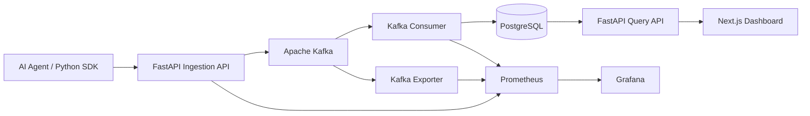

# AgentScope

### Real-Time Observability for AI Agents

**AgentScope** is an open-source distributed observability platform for AI-agent workflows. It captures agent, LLM, and tool execution spans, streams them through Apache Kafka, persists them in PostgreSQL, and visualizes execution traces through a Next.js dashboard.

With **v0.2**, AgentScope also supports automatic OpenAI Chat Completions instrumentation, capturing model calls, token usage, latency, and API errors without requiring developers to manually instrument every LLM call.

The platform includes Prometheus metrics, Grafana monitoring, and Kubernetes deployment manifests.

**Built with:** Python · FastAPI · Apache Kafka · PostgreSQL · Next.js · TypeScript · Docker · Kubernetes · Prometheus · Grafana

---

## Architecture



Kafka decouples ingestion from persistence, allowing trace events to accumulate while the database-writing consumer is temporarily unavailable.

### How It Works

1. An AI application generates execution spans using the AgentScope Python SDK.
2. The FastAPI ingestion endpoint validates and publishes spans to Kafka.
3. A separate Kafka consumer processes events and persists them in PostgreSQL.
4. The FastAPI query endpoints retrieve stored runs and spans.
5. The Next.js dashboard displays execution timelines, metadata, and errors.
6. Prometheus and Grafana provide infrastructure-level monitoring.

---

## Features

### Distributed Trace Ingestion

- HTTP-based trace ingestion through FastAPI
- Kafka-backed asynchronous processing
- Agent, LLM, and tool span classification
- Unique run and span identifiers
- Parent-child span relationships
- Structured JSON metadata stored in PostgreSQL

### Python Instrumentation SDK

The Python SDK supports:

- Context-managed traces and nested spans
- Automatic execution latency measurement
- Error status and exception-message capture
- Parent-span propagation within an execution context
- HTTP publishing to the AgentScope ingestion API
- Automatic OpenAI Chat Completions instrumentation (v0.2)

### Automatic OpenAI Instrumentation

AgentScope can automatically capture synchronous OpenAI Chat Completions calls inside an active trace.

Captured information includes:

- Model name and provider
- Request latency
- Prompt tokens, completion tokens, and total tokens
- API exceptions and error messages
- Parent-child relationships between agent and LLM spans

This allows developers to inspect model execution without manually creating an LLM span around every API call.

### Trace Visualization

The Next.js dashboard provides:

- Agent execution run summaries
- Run-level trace inspection
- Span status and execution details
- Trace waterfall visualization
- Error highlighting and exception messages
- Token usage and estimated LLM costs from recorded metadata

### Infrastructure Observability

Prometheus collects metrics from the ingestion API, Kafka consumer, and Kafka exporter.

Grafana visualizes:

- Total traces ingested
- Ingestion errors
- Consumer processing counts
- Kafka consumer lag

### Reliability

- Kafka consumer offsets committed after database writes
- PostgreSQL duplicate protection using `ON CONFLICT DO NOTHING`
- Kafka-backed buffering during consumer downtime
- Persistent Kafka and PostgreSQL Docker volumes
- Kubernetes deployment manifests for local cluster testing

---

## Getting Started

### Prerequisites

- Docker with Docker Compose
- Python 3.11+ for running the SDK and examples
- An OpenAI API key for live OpenAI requests (optional)

### Start the Platform

Clone the repository:

```bash
git clone https://github.com/adjascently/agentscope.git
cd agentscope
```

Build the application images:

```bash
docker build -f apps/api/Dockerfile -t agentscope-api:day3 .
docker build -f apps/web/Dockerfile -t agentscope-web:day2 .
```

Create the persistent Kafka volume:

```bash
docker volume create agentscope_kafka_data
```

Start the services:

```bash
docker compose -f docker-compose.yml -f docker-compose.monitoring.yml up -d
```

The `kafka-init` service automatically creates the `agent-traces` Kafka topic during startup.

### Service URLs

| Service | URL |
|---|---|
| Next.js Dashboard | http://localhost:3000 |
| FastAPI Documentation | http://localhost:8000/docs |
| FastAPI Metrics | http://localhost:8000/metrics |
| Prometheus | http://localhost:9091 |
| Grafana | http://localhost:3001 |

Grafana uses development credentials configured in Docker Compose. Change them before deploying outside a local environment.

### Generate Demo Traces

With the platform running, execute:

```bash
python3 examples/demo-agent/generate_traces.py
```

The generator publishes three simulated workflows:

1. **Research Assistant:** Planning, LLM calls, web search, and final response.
2. **Code Review Agent:** Repository inspection, LLM analysis, simulated test failure, and recovery.
3. **Customer Support Agent:** Planning, knowledge-base search, LLM response, and final answer.

The script generates **15 synthetic spans** across these three workflows.

Open http://localhost:3000 to inspect the generated runs.

---

## Python SDK

### Installation

From the repository root:

```bash
python3 -m venv .venv
source .venv/bin/activate
pip install -e "./packages/python-sdk[openai]"
```

The package distribution is named `agentscope-observability`, while the Python import remains `agentscope`.

### Manual Tracing

```python
from agentscope import AgentScope

tracer = AgentScope(endpoint="http://127.0.0.1:8000")

with tracer.trace("research-agent") as run_id:
    with tracer.span("plan", span_type="agent"):
        print("Planning research")

    with tracer.span(
        "llm.generate",
        span_type="llm",
        metadata={"model": "gpt-4o", "tokens": 150},
    ):
        print("Generating response")

    with tracer.span("search", span_type="tool"):
        print("Searching for information")

print("Run ID:", run_id)
```

The SDK measures span duration, captures errors, and publishes completed spans to the ingestion API.

### Automatic OpenAI Instrumentation (v0.2)

Instead of manually wrapping every OpenAI request, developers can instrument an OpenAI client.

```python
from openai import OpenAI
from agentscope import AgentScope, instrument_openai

tracer = AgentScope(endpoint="http://localhost:8000")
client = instrument_openai(OpenAI(), tracer)

with tracer.trace("research-assistant") as run_id:
    response = client.chat.completions.create(
        model="gpt-4o-mini",
        messages=[
            {
                "role": "user",
                "content": "Explain Apache Kafka in two sentences."
            }
        ],
    )

    print(response.choices[0].message.content)

print("Run ID:", run_id)
```

Set `OPENAI_API_KEY` in your environment before running.

OpenAI API billing is separate from ChatGPT subscriptions.

#### What Gets Recorded?

Each instrumented request creates an LLM span with metadata such as:

```json
{
  "provider": "openai",
  "model": "gpt-4o-mini",
  "prompt_tokens": 20,
  "completion_tokens": 15,
  "tokens": 35,
  "latency_ms": 125.4
}
```

The values above are illustrative. Actual token usage and latency depend on the request.

On an API exception, AgentScope records the span with `status: error` and captures the exception message.

#### Current Instrumentation Scope

- Synchronous, non-streaming OpenAI Chat Completions
- Requires an active `AgentScope.trace()` context
- Streaming and asynchronous instrumentation are not yet supported
- Other LLM providers are not yet automatically instrumented

See `examples/openai-agent/main.py` for an executable example.

---

## Integration Verification

### Live OpenAI API Failure

A real OpenAI API request was executed using `gpt-4o-mini`.

The request returned HTTP 429 with the error code `credit_balance_exhausted` because the API project had no remaining credits.

AgentScope successfully captured:

- An agent span and nested LLM span
- The OpenAI model name
- Request execution latency
- The API exception and error message
- The parent-child relationship
- Both failed spans in the Next.js dashboard

**Observed result:** 2 spans, 2 error statuses, and a 2.26-second overall execution timeline.

These represent one underlying API failure propagated through two execution spans, not two independent failed API requests.

### Mocked Successful OpenAI Response

A mocked OpenAI response was used to validate successful-response instrumentation without consuming API credits.

The mock returned:

| Metric | Recorded value |
|---|---:|
| Prompt tokens | 20 |
| Completion tokens | 15 |
| Total tokens | 35 |
| Captured spans | 2 |
| Error spans | 0 |

The test verified that the OpenAI instrumentation extracts token usage and publishes it through the existing AgentScope pipeline.

**Verification boundary:** Live API error tracing and mocked successful-response tracing have been verified. A successful live OpenAI API response has not yet been tested.

---

## Reliability Testing

### Kafka Consumer Failure Recovery

A controlled experiment was performed to validate Kafka buffering and consumer recovery.

**Procedure:**

1. Stop the Kafka consumer.
2. Submit 30 trace events through the FastAPI ingestion endpoint.
3. Confirm that Kafka consumer lag increases.
4. Restart the consumer.
5. Verify that queued events are processed and persisted.

**Observed results:**

| Metric | Result |
|---|---|
| Trace submissions | 30 |
| Successful HTTP submissions | 30/30 |
| Observed consumer lag during downtime | 30 |
| Observed lag after recovery | 0 |
| Traces recovered in PostgreSQL | 30/30 |
| Observed ingestion errors | 0 |

This experiment demonstrated successful buffering and recovery under the tested consumer-downtime scenario.

### Duplicate Protection

The same trace event was submitted twice using an identical `span_id`.

Both requests were accepted by the ingestion API, while PostgreSQL stored one row for that span identifier.

This demonstrates database-level idempotency for duplicate span IDs.

---

## API Overview

| Endpoint | Method | Purpose |
|---|---|---|
| `/health` | GET | API health check |
| `/v1/traces` | POST | Ingest a trace event |
| `/v1/runs` | GET | List recorded runs |
| Run-detail endpoint | GET | Retrieve spans for a run |
| `/metrics` | GET | Prometheus metrics |
| `/docs` | GET | Interactive API documentation |

The exact run-detail endpoint is documented in the running FastAPI OpenAPI specification at `/docs`.

---

## Repository Structure

```text
agentscope/
├── apps/
│   ├── api/                      # FastAPI API and Kafka consumer
│   └── web/                      # Next.js dashboard
├── packages/
│   └── python-sdk/
│       ├── pyproject.toml
│       └── agentscope/
│           ├── __init__.py
│           ├── tracer.py
│           └── openai_instrumentation.py
├── examples/
│   ├── demo-agent/               # Synthetic trace generator
│   └── openai-agent/             # OpenAI integration example
├── infra/
│   ├── grafana/                  # Grafana provisioning
│   ├── prometheus/               # Prometheus scrape configuration
│   └── k8s/                      # Kubernetes manifests
├── tests/
│   └── test_openai_integration.py
├── docker-compose.yml
├── docker-compose.monitoring.yml
└── README.md
```

---

## Engineering Decisions

**Why Kafka?**

Kafka decouples trace ingestion from database writes and allows the consumer to recover queued events after temporary downtime.

**Why PostgreSQL?**

PostgreSQL provides structured querying, indexes for run lookups, and JSONB storage for flexible span metadata.

**Why a separate consumer?**

Separating ingestion from persistence allows the API and database writer to run independently.

**Why Prometheus and Grafana?**

Together they provide visibility into ingestion activity, consumer processing, errors, and Kafka backlog.

**Why a Python SDK?**

A dedicated SDK provides a consistent interface for recording agent execution spans and makes integration easier than manually constructing trace events.

**Why automatic OpenAI instrumentation?**

Manually wrapping every model call introduces repetitive instrumentation work. Automatic interception allows developers to collect LLM execution metadata with less application-level tracing code.

---

## Current Limitations

- The current setup is intended for local development and demonstration, not production deployment.
- Kafka runs as a single broker with replication factor one.
- The SDK logs failed HTTP submissions but does not currently retry them.
- Token usage and cost estimates depend on recorded metadata and available pricing assumptions.
- The synthetic demo generator remains available alongside OpenAI instrumentation.
- Automatic OpenAI instrumentation currently supports synchronous, non-streaming Chat Completions only.
- A successful live OpenAI API response has not yet been verified.
- Authentication, multi-tenancy, and production-grade security controls are not implemented.
- Automatic failure diagnosis and remediation recommendations are planned, not yet implemented.

---

## Roadmap

### v0.2 — OpenAI Instrumentation

- [x] Installable Python SDK
- [x] Automatic OpenAI Chat Completions tracing
- [x] Token usage and latency capture
- [x] API error instrumentation
- [x] Live failure tracing verification
- [x] Mocked successful-response verification

### Next — Actionable Failure Diagnosis

- [ ] Detect common agent execution failures
- [ ] Identify likely root causes
- [ ] Link diagnoses to supporting span evidence
- [ ] Provide actionable remediation suggestions
- [ ] Evaluate detection precision and recall using labeled scenarios
- [ ] Display diagnoses in the Next.js dashboard

### Future Improvements

- [ ] Streaming and async OpenAI instrumentation
- [ ] Additional LLM provider integrations
- [ ] Configurable sampling and batching
- [ ] Authentication and multi-tenant isolation
- [ ] Production deployment hardening

---

## Stopping the Platform

```bash
docker compose -f docker-compose.yml -f docker-compose.monitoring.yml down
```

Persistent Docker volumes are retained unless explicitly removed.

---

**AgentScope — Built to make AI-agent execution observable, debuggable, and measurable.**
